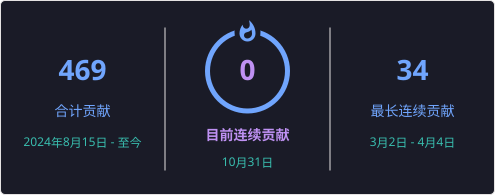

  <h1>Hi 👋, I'm sonwwall</h1>
  
<strong>Go developer · Building reliable backend systems and AI-powered tools</strong>

  

 

## 👨‍💻 About me

- 🔭 I'm currently working on **Backend Development Intern**
- 🌱 I'm currently learning **Go and Agent**
- 📫 How to reach me: **2233like@gmail.com**
- ⚡ Fun fact: **happy coding, happy life**
- 📝 I regularly write articles on [sonwwall.github.io](https://sonwwall.github.io/)

## 📊 GitHub stats

  
  

## 🔥 Contribution streak

  

## 📝 Latest articles

<!-- BLOG-POST-LIST:START -->
- [SSE 在 AI Agent 长任务中的连接管理与状态恢复](https://sonwwall.github.io/posts/learning-note-20261026/) — `2026-10-26`
- [大文件批量同步系统：性能、幂等与断点恢复设计](https://sonwwall.github.io/posts/large-file-batch-sync-design-2026/) — `2026-10-26`
- [MySQL 字段扩展与宽表设计：从 5.6 Online DDL 到 8.0 INSTANT](https://sonwwall.github.io/posts/mysql-field-extension-wide-table-design-2026/) — `2026-10-13`
- [学习笔记：Git Worktree 的使用与理解](https://sonwwall.github.io/posts/learning-note-20260827/) — `2026-08-27`
- [第二十六节：缓存置换算法：LRU 用什么数据结构实现更合理？](https://sonwwall.github.io/posts/cache-replacement-lru-data-structure-2026/) — `2026-07-28`
<!-- BLOG-POST-LIST:END -->
